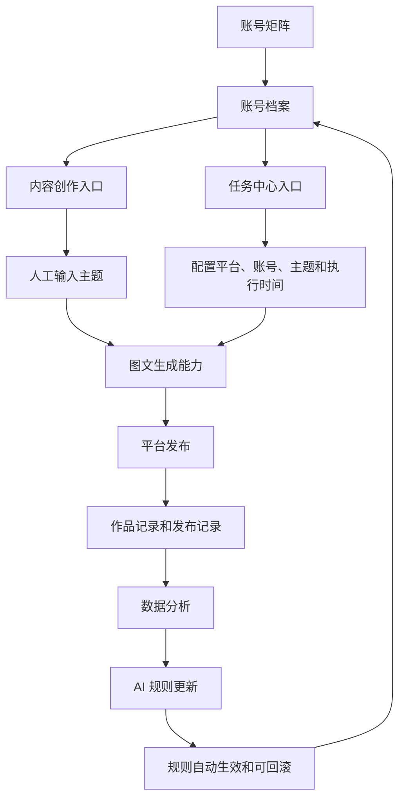
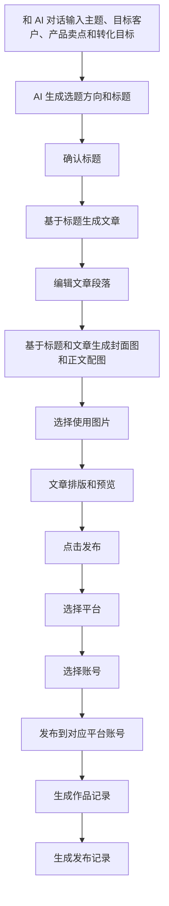
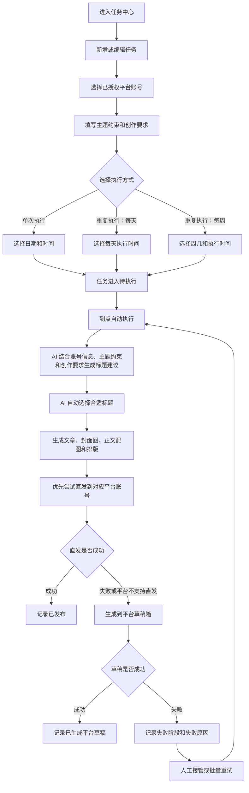

# 新媒体矩阵运营工作台 PRD 草案

## 1. 产品定位

新媒体矩阵运营工作台是面向企业多平台账号运营的后台系统，核心解决多账号管理、内容自动生成、定时任务执行、数据反馈分析和 AI 自动优化的问题。

产品不按单一运营流程组织，而是按业务对象组织，核心模块包括：

- 账号矩阵
- 数据分析
- 内容创作
- 任务中心
- 系统设置

V1 阶段支持微信公众号、视频号、小红书、抖音四个平台进入账号矩阵。账号登录统一采用本地独立 Chrome 打开平台真实管理后台，由用户使用对应平台 App 扫码并保存独立登录态；微信公众号在具备开放平台资质和接口权限后，可进一步切换为官方授权、草稿箱、发布和数据统计接口。浏览器自动化 / RPA 需要在产品中标注稳定性、风控和人工接管边界。

## 2. 背景与问题

当前新媒体运营中存在以下问题：

- 多账号管理分散，账号定位、运营人、平台授权和账号状态难以统一维护。
- 内容创作依赖人工，选题、写稿、排版、发布流程重复，效率较低。
- 数据反馈分散，难以按账号和作品持续复盘内容效果。
- AI 生成内容缺少账号记忆，无法长期结合账号定位和历史表现持续优化。
- 定时任务和多任务并行能力不足，难以支撑矩阵化运营。

因此，需要建设一个以账号矩阵为基础，以数据反馈为驱动，以 AI 内容生成和自动任务为核心能力的新媒体运营工作台。

## 3. 核心目标

- 提高运营效率：减少人工选题、写稿、发布、复盘的重复操作。
- 支持矩阵管理：统一管理多个平台、多个账号。
- 实现自动化发布闭环：支持即时生成内容、定时任务自动生成内容，并优先尝试直发；如平台不支持直发或直发失败，则生成到对应平台草稿箱，平台草稿也视为任务完成。
- 建立数据闭环：基于账号和作品数据反馈，自动调整后续内容策略。
- 沉淀账号记忆：每个账号形成独立定位、用户画像、风格偏好和 AI 动态规则。

## 4. 竞品分析

| 竞品 | 链接 | 竞品定位 | 参考价值 | 可借鉴点 | 我们的取舍 / 差异化 |
| --- | --- | --- | --- | --- | --- |
| 新榜矩阵通 | [打开官网](https://matrix.newrank.cn/media) | 多平台数字化内容资产管理中台 | 与本项目定位最接近，适合作为账号矩阵、数据总览和账号管理模块的重要参考 | 账号矩阵统一管理、平台筛选、团队/运营人筛选、授权状态、账号标签、自定义字段、数据总览、表格化账号池 | V1 可重点参考账号矩阵结构和数据总览方式，但不照搬完整内容资产管理逻辑；本项目更强调 AI 内容生成、自动发布任务和数据反馈后的账号规则自优化 |
| 壹伴 | [打开官网](https://yiban.io/) | 公众号图文编辑与运营增强工具 | 适合作为 V1 公众号图文生成、编辑、排版能力的参考 | 公众号图文编辑、AI 写作、标题生成、正文生成、排版辅助、素材/封面辅助、公众号运营增强 | 壹伴偏单平台编辑工具，本项目不是单纯编辑器；V1 参考其图文能力，但整体仍以账号矩阵、任务中心和数据闭环为核心 |
| 蚁小二 | [打开官网](https://www.yixiaoer.cn/) | 自媒体多平台多账号一键分发管理工具。 | 直接竞品池，偏多平台分发和账号管理。 | 多平台账号管理、多账号内容分发、批量任务处理、数据统计能力。 | 蚁小二只是多平台一键分发和账号管理，而且只有视频生成相关的功能，我们要从账号档案、内容生成、自动发布、数据反馈到 AI 规则更新形成闭环。 |
| Hootsuite | [打开官网](https://www.hootsuite.com/) | 企业级社交媒体管理平台 | 适合作为长期企业级多账号运营、数据洞察和 AI 建议能力的参考 | 多账号管理、批量排期、社媒趋势洞察、AI 生成、AI 数据问答、最佳发布时间建议 | V1 不做复杂社媒监听和企业级协作，优先聚焦账号矩阵、图文生成、自动任务和数据反馈闭环 |

### 4.1 竞品分析结论

现有竞品大致分为三类：

1. 账号矩阵类：以新榜矩阵通为代表，强在多账号管理、授权状态、数据总览和账号筛选。
2. 内容创作类：以壹伴为代表，强在公众号图文编辑、AI 写作和排版辅助。

本项目的差异化方向是：以账号矩阵作为基础对象，以内容创作作为效率工具，以任务中心实现自动化执行，以数据分析驱动 AI 自动调整账号内容规则，从“工具辅助运营”升级为“AI 驱动的矩阵运营工作台”。

## 5. 信息架构

系统采用偏业务对象的信息架构，一级模块建议如下：

| 一级模块 | 说明 |
| --- | --- |
| 首页 | 查看整体运营概览、今日任务、账号数据和快捷入口 |
| 账号矩阵 | 统一管理多平台账号、账号档案、授权状态和账号标签 |
| 数据分析 | 按账号和作品查看各平台数据反馈 |
| 内容创作 | 通过标题确认、文章生成、图片生成和文章排版完成图文创作，并支持排版后发布 |
| 草稿箱 | 保存内容创作各步骤草稿，并支持从对应步骤继续创作 |
| 任务中心 | 管理定时任务、多任务并行、执行状态和失败重试 |
| 系统设置 | 管理平台授权、团队成员、AI 配置和发布配置 |

## 6. 核心业务流程

核心业务流程用于说明账号矩阵、内容创作、任务中心、数据分析和 AI 规则更新之间的关系，只表达业务流转，不涉及具体页面原型。

### 6.1 整体业务闭环图

### 6.2 人工内容创作流程图

### 6.3 任务中心定时自动生成发布流程图

## 7. 核心模块

### 7.1 账号矩阵

账号矩阵用于统一管理各平台账号，是“账号管理 + AI 账号档案”的基础模块。

账号矩阵需要同时支撑三类后续能力：

- 内容创作：生成内容时读取账号定位、面向用户、内容风格和禁忌方向。
- 任务执行：创建自动任务时选择平台账号，并绑定账号授权状态。
- 数据反馈：AI 根据账号和作品数据更新账号动态偏好。

账号矩阵采用“列表页 + 独立详情页”结构。列表页用于账号管理、筛选和批量操作；独立详情页用于维护单个账号的基础信息、授权状态和 AI 档案。

#### 7.1.1 页面参考

账号矩阵页面可参考新榜矩阵通的后台结构：

- 左侧为一级导航和模块内二级菜单。
- 模块内展示账号管理状态总览。
- 主区域以表格形式展示账号列表。
- 支持平台、团队、运营人、授权情况、账号标签等筛选。

#### 7.1.2 列表页结构

账号矩阵列表页包含：

| 区域 | 内容 |
| --- | --- |
| 管理状态总览 | 已添加账号数、已授权账号数、监测中账号数、授权失效账号数 |
| 平台分布 | 按公众号、视频号、小红书等平台展示账号数量 |
| 筛选区 | 平台、团队、运营人、授权状态、监测状态、账号标签 |
| 操作区 | 添加账号、批量授权、授权检测、更新账号信息、自定义字段 |
| 账号表格 | 展示账号名称、平台、标签、运营人、授权状态、监测状态、添加时间、操作 |

账号矩阵列表页只展示账号管理状态，不展示粉丝数、播放量、点赞数等运营效果数据。运营效果数据统一进入数据分析模块。

#### 7.1.3 添加账号与数据同步流程

- 用户点击添加账号，选择微信公众号、视频号、小红书或抖音。
- 选择平台后，系统在本机自动打开独立 Chrome 窗口，并进入该平台真实的官方登录或管理后台页面；工作台本身不生成模拟二维码。
- 用户在平台真实页面使用对应平台 App 扫码并完成平台确认。
- 系统持续检测真实登录结果，只有确认登录成功后才创建账号记录，并为该账号保存独立浏览器登录态；账号名称和平台账号 ID 优先从平台登录页及登录会话中真实读取。
- 登录成功后关闭登录窗口，账号进入账号矩阵；登录超时、用户关闭窗口或扫码失败时不创建账号。账号标签和运营人属于工作台内部管理字段，平台不会返回；默认分别显示“未设置”和“未分配”，由用户在账号编辑入口维护。
- 后续数据同步、定时发布和人工接管复用该账号独立登录态，不共享不同账号的 Cookie。
- 授权失效时，账号不能用于定时任务发布，需要重新打开平台真实登录页扫码。
- 微信公众号在具备开放平台资质和接口权限后，可切换到官方接口；V1 的真实网页登录能力仍需保留，作为内部使用和人工接管入口。

#### 7.1.4 主要功能

- 添加账号
- 账号授权
- 账号批量授权
- 授权状态检测
- 更新账号信息
- 平台筛选
- 账号标签
- 运营人筛选
- 自定义字段
- 账号详情配置

#### 7.1.5 账号列表字段

| 字段 | 说明 |
| --- | --- |
| 账号名称 | 平台账号名称 |
| 平台 | 公众号、视频号、小红书等 |
| 账号标签 | 自定义标签，用于分类管理 |
| 运营人 | 当前负责运营的人员 |
| 添加时间 | 账号加入系统的时间 |
| 授权状态 | 未授权、已授权、授权失效 |
| 监测状态 | 是否开启数据监测 |
| 操作 | 设置、查看详情、更新信息等 |

#### 7.1.6 账号详情页结构

账号详情页用于维护单个账号的管理信息和 AI 档案，不展示完整运营数据详情。

账号详情页包含：

| 区块 | 字段 |
| --- | --- |
| 基础信息 | 平台、账号名称、账号 ID、账号头像、账号标签、所属团队、运营人 |
| 授权与监测 | 授权状态、授权时间、授权失效时间、监测状态、最近同步时间、更新账号信息 |
| AI 账号档案 | 角色定位、面向用户、内容方向、内容风格、禁忌方向、常用主题、平台内容要求 |
| AI 动态偏好 | 标题偏好、内容角度偏好、表达方式偏好、发布时间偏好、规则变更记录、回滚入口 |

#### 7.1.7 账号详情字段

| 字段 | 说明 |
| --- | --- |
| 平台 | 账号所属平台 |
| 账号名称 | 账号展示名称 |
| 授权状态 | 平台授权状态 |
| 运营人 | 账号负责人 |
| 账号标签 | 账号分类标签 |
| 角色定位 | 账号在内容表达中的角色，例如 AI 记账顾问 |
| 面向用户 | 目标受众，例如小微企业主、个体户、财务人员 |
| 内容方向 | 账号长期内容主题方向 |
| 内容风格 | 专业、轻松、案例型、科普型等 |
| 禁忌方向 | 不希望生成或发布的内容方向 |
| 常用主题 | 账号长期高频创作主题 |
| 平台内容要求 | 不同平台对内容结构、字数、格式的要求 |
| AI 动态偏好 | AI 根据数据反馈自动沉淀的偏好规则 |

#### 7.1.8 边界说明

- 账号详情页不放完整数据分析，避免和数据分析模块重复。
- 账号矩阵页只展示管理状态总览，不展示粉丝、播放、点赞等运营效果数据。
- 运营效果数据统一放到数据分析模块。
- 账号档案是后续 AI 内容生成和 AI 规则自优化的核心输入。

### 7.2 数据分析

数据分析模块用于集中查看各平台账号和作品的数据表现，并为 AI 自动调整账号内容规则提供依据。

数据分析第一阶段只展示已同步的账号数据和作品数据，不做 AI 复盘建议。后续再承接“数据反馈 -> AI 规则更新 -> 后续内容优化”的闭环。

页面结构采用“账号数据 / 作品数据”两个标签页，不展示“AI 规则变更”。选择“账号数据”时只显示账号汇总指标和账号数据表格；选择“作品数据”时只显示作品数据表格，两个区域不同时展示。

#### 7.2.1 账号数据

账号维度用于查看每个账号在各平台的整体表现。

支持筛选：

- 平台
- 账号
- 运营人
- 时间范围
- 账号标签

主要字段：

| 字段 | 说明 |
| --- | --- |
| 账号名称 | 当前账号 |
| 平台 | 所属平台 |
| 粉丝数 | 当前粉丝量 |
| 阅读量 / 播放量 | 统计周期内内容总阅读或播放 |
| 推荐数 | 平台将作品推荐给用户的次数 |
| 点赞数 | 统计周期内总点赞 |
| 评论数 | 统计周期内总评论 |
| 转发数 | 统计周期内总转发 |
| 收藏数 | 统计周期内总收藏 |
| 数据更新时间 | 最近一次同步时间 |

#### 7.2.2 作品数据

作品维度用于查看每篇内容的具体表现。

支持筛选：

- 平台
- 账号
- 内容类型
- 发布时间
- 关键词

主要字段：

| 字段 | 说明 |
| --- | --- |
| 作品标题 | 内容标题 |
| 所属平台 | 内容发布平台 |
| 所属账号 | 内容发布账号 |
| 内容类型 | 图文、视频、笔记等 |
| 阅读量 / 播放量 | 内容曝光或播放数据 |
| 推荐数 | 平台将该作品推荐给用户的次数 |
| 点赞数 | 内容点赞数据 |
| 评论数 | 内容评论数据 |
| 转发数 | 内容传播数据 |
| 收藏数 | 内容收藏数据 |
| 发布时间 | 内容发布时间 |
| 发布状态 | 已发布、发布失败等 |
| 数据更新时间 | 最近一次数据同步时间 |

#### 7.2.3 AI 规则变更

数据分析模块需要展示 AI 基于数据反馈自动做出的规则调整。

| 字段 | 说明 |
| --- | --- |
| 账号 | 被调整规则的账号 |
| 规则类型 | 标题偏好、内容角度、表达风格、发布时间等 |
| 调整原因 | 基于哪些数据表现触发调整 |
| 调整前 | 原规则 |
| 调整后 | 新规则 |
| 生效时间 | 规则自动生效时间 |
| 操作 | 查看详情、回滚 |

#### 7.2.4 V1 指标范围

V1 只做基础互动指标：

- 粉丝数
- 阅读量 / 播放量
- 推荐数
- 点赞数
- 评论数
- 转发数
- 收藏数

推荐数指平台将作品推荐给用户的次数，用于判断内容被平台分发的情况。它和阅读量 / 播放量不同，推荐数更偏“平台分发能力”，阅读量 / 播放量更偏“用户实际消费结果”。

V1 暂不重点做：

- 互动率
- 完播率
- 涨粉率
- 转化率
- ROI
- 线索数据

#### 7.2.5 AI 数据反馈

AI 后续根据账号和作品数据自动调整账号内容规则，例如：

- 标题风格
- 内容角度
- 表达方式
- 发布时间倾向
- 用户关注点
- 选题方向

### 7.3 内容创作

内容创作是运营人员主动进行公众号图文创作的板块，用于通过 AI 辅助完成标题确认、文章生成、图片生成和文章排版。平台和账号在文章排版完成并点击“发布”后再选择。

V1 阶段先支持图文生成，后续预留视频生成工具接入。内容创作页面调用底层图文生成能力，根据用户输入的主题生成图文内容。

内容创作页本身不负责账号档案读取。账号档案在发布阶段选择账号后读取，用于匹配发布账号、记录作品归属，并为后续数据反馈和 AI 规则更新提供关联关系。

定时任务中的自动生成不属于内容创作页面流程，由任务中心到点后自动触发同一套图文生成能力。

#### 7.3.1 页面结构

内容创作模块包含：

| 步骤 | 说明 |
| --- | --- |
| 标题确认 | 通过和 AI 对话输入想写的主题、目标客户、产品卖点和转化目标，AI 生成选题方向和标题 |
| 生成文章 | 基于已确认标题生成公众号文章内容，并按段落展示和编辑 |
| 生成图片 | 基于标题和文章内容生成封面图和正文配图，支持重新生成和选择图片 |
| 文章排版 | 组合标题、文章内容、封面图和正文配图，支持编辑排版、预览和直接发布 |
| 草稿箱 | 自动保存内容创作中每一步的结果，支持从对应步骤恢复继续创作 |
| 发布配置区 | 文章排版页点击发布后选择平台和账号 |
| 发布结果区 | 展示发布状态、平台返回结果和失败原因 |

#### 7.3.2 创作流程

1. 用户在“标题确认”中和 AI 对话，输入想写的内容、目标客户、产品卖点和转化目标。
2. AI 生成选题方向和标题，用户确认标题。
3. 用户进入“生成文章”，系统基于已确认标题生成公众号文章内容。
4. 用户按段落编辑文章内容，系统实时保存到草稿箱。
5. 用户进入“生成图片”，系统基于标题和文章内容生成公众号封面图和正文配图。
6. 用户选择要使用的封面图和正文配图，可重新生成图片。
7. 用户进入“文章排版”，系统组合标题、正文、封面图和配图生成排版预览。
8. 用户编辑排版并点击发布。
9. 用户选择发布平台和账号。
10. 系统读取所选账号档案，并将作品发布到对应平台账号。
11. 系统生成作品记录和发布记录。

#### 7.3.3 输入信息

| 字段 | 说明 |
| --- | --- |
| 想写的内容 | 用户通过对话描述本次想写的主题或方向 |
| 目标客户 | 本次内容面向的人群，例如小微企业老板、个体户、财务人员 |
| 产品卖点 | 本次内容需要体现的产品能力或服务价值 |
| 转化目标 | 本次内容希望达成的目标，例如咨询、试用、加群、领取资料 |
| 已确认标题 | 用户最终确认用于生成文章的标题 |

#### 7.3.4 发布信息

| 字段 | 说明 |
| --- | --- |
| 平台 | 文章排版页点击发布后选择 |
| 账号 | 文章排版页点击发布后选择，支持选择一个或多个 |
| 账号档案 | 选择账号后读取，用于记录作品归属和后续数据反馈 |

#### 7.3.5 输出内容

| 字段 | 说明 |
| --- | --- |
| 所属账号 | 当前内容对应的发布账号 |
| 选题方向 | AI 根据用户对话生成的内容方向 |
| 标题 | 用户确认后的标题 |
| 正文段落 | AI 基于标题生成的公众号文章正文 |
| 封面图 | AI 基于标题和文章内容生成的公众号封面图 |
| 正文配图 | AI 基于文章内容生成的正文配图 |
| 排版预览 | 标题、正文、封面图和正文配图组合后的公众号文章预览 |
| 发布状态 | 未发布、发布中、已发布、发布失败 |

#### 7.3.6 发布规则

- 内容创作阶段包含标题确认、生成文章、生成图片和文章排版四个步骤。
- 每个步骤完成后，系统都需要自动保存到草稿箱。
- 草稿箱需要记录当前完成步骤，并支持用户从对应步骤继续创作。
- 页面内步骤条只展示四个步骤，不展示发布。
- 发布是文章排版完成后的页面操作。
- 用户在文章排版页点击发布后，再选择发布平台和账号。
- 单账号发布时，将当前内容发布到该账号。
- 多账号发布时，可以将当前内容发布到多个账号，发布状态分别记录。
- 用户确认发布后，系统创建作品记录和发布记录。
- 发布失败时，需要展示失败原因，并允许从发布记录或任务详情中重试。
- V1 不设置强制审核流，是否增加人工确认作为后续待确认项。

#### 7.3.7 草稿箱联动

草稿箱用于保存人工内容创作过程中的中间结果。用户完成任一步骤后，系统都需要生成或更新草稿记录。

草稿箱列表建议展示：

| 字段 | 说明 |
| --- | --- |
| 草稿标题 | 当前已确认标题，未确认标题时展示用户输入的主题摘要 |
| 当前步骤 | 标题确认、生成文章、生成图片、文章排版 |
| 内容类型 | V1 默认为公众号图文 |
| 更新时间 | 草稿最近一次自动保存时间 |
| 运营人 | 当前草稿创建或编辑人 |
| 操作 | 继续创作、删除草稿 |

#### 7.3.8 边界说明

主题只是内容创作的输入参数，不作为任务中心的一级管理对象。

内容创作模块偏人工主动操作；任务中心偏自动化调度执行。两者共用底层图文生成能力，但入口和执行流程不同。

任务中心到点自动生成图文并发布时，不需要用户进入内容创作页面完成生成。

V1 仅支持图文生成，不做视频自动生成。后续接入视频生成工具时，可在内容类型中扩展短视频脚本、分镜、素材生成等能力。

### 7.4 任务中心

任务中心用于管理自动化任务，不按主题分组。任务中心关注“哪个平台、哪个账号、什么时间、执行什么动作、执行结果如何”。

任务中心是定时自动化入口。用户可以新增任务，也可以编辑已有任务。新增任务时，需要选择已授权账号、填写主题约束、填写创作要求、选择任务类型和执行方式。主题只是选题约束，不作为最终标题；任务到点后，系统会结合账号信息、主题约束和创作要求，在内容创作的“标题确认”能力中生成标题建议，并由 AI 自动选择合适标题继续生成文章、图片和排版。

V1 四个平台均进入任务配置范围。微信公众号优先使用官方接口；视频号、小红书、抖音第一阶段允许本地内部浏览器自动化 / RPA 跑通。发布策略为优先直发，直发失败或平台不支持直发时生成到平台草稿箱。平台草稿生成成功也算任务完成，状态显示为“已生成平台草稿”。

任务的核心定义是：

> 任务 = 平台 + 账号 + 执行时间 + 执行动作

任务中心支持多任务并行执行。同一个主题如果要发多个账号，可以创建多条任务，但任务中心仍按任务条目平铺展示，不做“主题任务 -> 子任务”的层级结构。

#### 7.4.1 页面结构

任务中心包含：

| 页面 / 区域 | 说明 |
| --- | --- |
| 任务列表 | 按平台、账号、时间、状态查看任务，并支持查看详情、编辑和删除 |
| 新增任务 | 选择已授权账号，配置主题约束、创作要求、任务类型和执行方式 |
| 编辑任务 | 修改已有任务的账号、主题约束、创作要求、任务类型、执行方式和执行时间，未修改项沿用原配置 |
| 任务详情 | 查看任务配置、生成内容、发布结果、失败原因和重试记录 |
| 状态筛选 | 按待执行、执行中、已发布、已生成平台草稿、失败、已重试筛选 |
| 批量重试 | 对失败任务进行多选，并立即重新执行选中的失败任务 |

#### 7.4.2 任务列表字段

| 字段 | 说明 |
| --- | --- |
| 平台 | 公众号、视频号、小红书等 |
| 账号 | 执行任务的账号 |
| 执行时间 | 任务计划执行时间 |
| 任务类型 | 微信公众号图文生成、小红书图文生成等，按平台能力执行 |
| 选定标题 | 任务执行时由 AI 基于主题、账号信息和创作要求自动生成并选择 |
| 任务状态 | 待执行、执行中、已发布、已生成平台草稿、失败、已重试 |
| 关联内容 | 任务生成的内容项目、草稿和待发布包 |
| 失败原因 | 任务失败时展示 |
| 重试记录 | 展示任务重试次数和结果 |

#### 7.4.3 新增 / 编辑任务字段

| 字段 | 说明 |
| --- | --- |
| 平台 | 新增任务时配置；编辑任务时可修改，不修改则沿用原配置 |
| 账号 | 新增任务时配置；编辑任务时可修改，不修改则沿用原配置 |
| 主题 | 新增任务时配置；编辑任务时可修改，不修改则沿用原配置。主题只是选题约束，不直接作为最终文章标题 |
| 创作要求 | 非必填，用于补充文章中想加入的例子、客户群体、表达要求等 |
| 选定标题 | 任务执行时由 AI 自动生成并选择，不在新建任务时人工选择 |
| 任务类型 | 新增任务时配置；编辑任务时可修改，不修改则沿用原配置。微信公众号优先使用官方接口；视频号、小红书、抖音第一阶段按本地内部浏览器自动化 / RPA 跑通 |
| 执行方式 | 单次执行、重复执行 |
| 执行时间 | 位于执行方式配置之后；单次执行只选择执行时间 |
| 重复规则 | 选择重复执行后展示；支持每天、每周。每天只需选择执行时间；每周需要选择周几和执行时间 |
| 发布配置 | 优先直发；直发失败或平台不支持直发时生成平台草稿箱，草稿成功也算任务完成 |

#### 7.4.4 任务类型

V1 任务类型：

- 微信公众号图文生成：优先使用官方接口执行
- 小红书图文生成：第一阶段允许本地内部浏览器自动化 / RPA 执行
- 视频号内容发布：第一阶段允许本地内部浏览器自动化 / RPA 执行
- 抖音内容发布：第一阶段允许本地内部浏览器自动化 / RPA 执行

后续可扩展：

- 视频创作
- 生成草稿
- 发布草稿
- 同步数据
- 生成数据报告

#### 7.4.5 定时规则

V1 支持：

- 单次任务
- 重复任务：每天、每周
- 多任务并行执行

暂不做复杂的自动排期算法。

重复任务无结束时间，用户可通过删除任务停止后续执行。

任务到点后由系统自动执行，不进入内容创作页面；生成内容、待发布包、发布结果、平台草稿结果和失败原因在任务详情中查看。

#### 7.4.6 任务状态

| 状态 | 说明 |
| --- | --- |
| 待执行 | 任务已创建，尚未到执行时间 |
| 执行中 | 系统正在生成内容或发布内容 |
| 已发布 | 内容生成并成功发布到对应平台账号 |
| 已生成平台草稿 | 内容生成并成功进入对应平台草稿箱，等待人工确认发布 |
| 失败 | 内容生成或发布失败 |
| 已重试 | 失败任务已触发过重试 |

#### 7.4.7 任务详情

点击任务条目后，进入任务详情。

任务详情包含：

- 平台
- 账号
- 执行时间
- 任务类型
- 任务状态
- 创作主题
- 账号定位
- 面向用户
- 内容风格
- 生成内容
- 发布结果、平台草稿状态和待发布包
- 失败原因
- 重试记录

#### 7.4.8 失败处理

- 任务失败时需要记录失败阶段：生成失败、发布失败、接口失败、授权失效等。
- 任务失败时需要展示失败原因。
- 任务失败后支持人工重试；批量重试时可以多选失败任务并立即重新执行。
- 如果账号授权失效，应提示用户先处理账号授权。
- 多任务并行时，单个任务失败不影响其他任务继续执行。

### 7.5 首页

首页用于展示整体运营概览和常用入口，帮助用户快速了解当前账号矩阵、任务和数据状态。

首页建议包含：

| 区块 | 内容 |
| --- | --- |
| 账号概览 | 已添加账号数、已授权账号数、授权失效账号数 |
| 今日任务 | 今日待执行、执行中、成功、失败任务数量 |
| 内容概览 | 今日生成内容数、今日发布内容数、发布失败数 |
| 数据摘要 | 关键账号或作品的数据变化摘要 |
| 快捷入口 | 添加账号、创建内容、创建定时任务、查看数据分析 |

首页只做概览和入口，不承载完整的数据分析和账号管理能力。

### 7.6 系统设置

系统设置用于维护平台接入、成员和基础配置，不承载日常运营流程。日常账号管理、数据查看、内容创作和任务执行仍分别在账号矩阵、数据分析、内容创作和任务中心中完成。

V1 建议包含：

| 配置项 | 说明 |
| --- | --- |
| 平台授权配置 | 管理公众号等平台接入配置 |
| 团队成员 | 管理系统成员和所属团队 |
| 运营人配置 | 用于账号负责人筛选和任务归属 |
| AI 配置 | 管理 AI 生成能力的基础配置 |
| 发布安全配置 | 管理发布前确认、失败提醒等安全策略 |

#### 7.6.1 平台授权配置

平台授权配置用于维护平台接入状态和授权入口。

| 字段 | 说明 |
| --- | --- |
| 平台 | 公众号、视频号、小红书等 |
| 授权状态 | 未授权、已授权、授权失效 |
| 授权账号数 | 当前平台已接入账号数量 |
| 最近检测时间 | 最近一次授权状态检测时间 |
| 操作 | 去授权、检测授权、查看接入说明 |

V1 不在 PRD 中细化 AppID、密钥、回调地址等技术参数，仅描述产品侧配置能力。

#### 7.6.2 团队成员

团队成员用于维护系统使用人员，支撑账号负责人、任务归属和基础协作。

| 字段 | 说明 |
| --- | --- |
| 成员姓名 | 系统成员名称 |
| 手机号 / 邮箱 | 成员联系方式 |
| 所属团队 | 成员所属团队 |
| 状态 | 启用、停用 |
| 操作 | 新增、编辑、停用 |

V1 只做基础成员管理，不细化复杂角色权限、菜单权限和数据权限。

#### 7.6.3 运营人配置

运营人配置用于维护可分配到账号和任务上的运营人员。

| 字段 | 说明 |
| --- | --- |
| 运营人 | 可被选择为账号负责人或任务负责人 |
| 所属团队 | 运营人所属团队 |
| 负责账号数 | 当前绑定的账号数量 |
| 状态 | 启用、停用 |
| 操作 | 新增、编辑、停用 |

运营人配置需要和账号矩阵中的运营人筛选、任务中心中的任务归属保持一致。

#### 7.6.4 AI 配置

AI 配置用于维护内容生成和规则自动更新的基础策略。

| 字段 | 说明 |
| --- | --- |
| 默认生成模型 | 内容创作和定时任务默认使用的生成模型 |
| 生成风格默认值 | 默认写作风格，例如专业、科普、案例化等 |
| 敏感词 / 禁忌方向 | 生成内容时需要规避的词和方向 |
| 规则自动生效开关 | 控制 AI 根据数据反馈改写账号规则后是否自动生效 |
| 回滚记录入口 | 查看 AI 规则变更记录，并支持回滚 |

V1 不做多模型复杂路由，只提供默认模型和基础生成策略配置。

#### 7.6.5 发布安全配置

发布安全配置用于控制自动发布过程中的基础风险提示。

| 字段 | 说明 |
| --- | --- |
| 发布前确认 | 控制立即发布或定时发布前是否需要人工确认 |
| 失败提醒 | 任务生成或发布失败时提醒相关运营人 |
| 重试提醒 | 失败任务触发重试或重试失败时提醒相关运营人 |
| 授权失效提醒 | 平台账号授权失效时提醒相关运营人或管理员 |
| 提醒方式 | 站内通知、消息中心等基础提醒方式 |

V1 默认不设置强制审核流。发布前确认作为可配置项保留，是否开启由系统配置决定。

#### 7.6.6 边界说明

- 系统设置只提供基础配置能力，不承载日常运营流程。
- V1 不细化复杂权限体系。
- V1 不细化平台接口技术参数。
- 平台授权、AI 配置和发布安全配置需要服务于账号矩阵、内容创作和任务中心。

## 8. AI 数据反馈闭环

AI 不只是生成内容，还要基于数据反馈调整账号规则。AI 数据反馈闭环是连接“数据分析、账号档案、内容创作、任务中心”的核心机制。

### 8.1 闭环流程

1. 内容发布。
2. 平台数据回流。
3. 系统按账号和作品分析表现。
4. AI 判断哪些内容方向、标题结构、表达风格、发布时间效果更好。
5. AI 自动更新账号动态偏好。
6. 后续内容生成自动应用新规则。

### 8.2 规则变更方式

AI 规则更新采用：

- 自动生效
- 保留变更记录
- 支持回滚

规则自动生效后，需要在账号详情页和数据分析模块中都能查看变更记录。

### 8.3 AI 规则版本字段

| 字段 | 说明 |
| --- | --- |
| 账号 | 规则所属账号 |
| 规则类型 | 标题、内容方向、表达风格、发布时间等 |
| 变更前内容 | 原规则内容 |
| 变更后内容 | 新规则内容 |
| 数据依据 | 触发变更的数据表现 |
| 生效时间 | 规则生效时间 |
| 操作 | 查看详情、回滚 |

### 8.4 可调整规则范围

V1 可调整的规则范围包括：

| 规则类型 | 说明 |
| --- | --- |
| 标题偏好 | 根据推荐数、阅读量 / 播放量、点赞等数据调整标题结构 |
| 内容角度 | 根据高表现作品提炼更适合账号的内容切入点 |
| 表达风格 | 根据互动表现调整专业、口语化、案例化等表达倾向 |
| 发布时间 | 根据内容表现调整后续建议发布时间 |
| 禁忌方向 | 根据低表现内容弱化不适合继续创作的方向 |

### 8.5 回滚规则

- 每次 AI 规则更新都需要生成规则版本记录。
- 用户可以查看调整前、调整后和数据依据。
- 用户可以回滚到上一版本规则。
- 回滚后，后续内容生成应使用回滚后的规则。
- 回滚行为也需要记录到规则变更记录中。

## 9. V1 范围

### 9.1 V1 重点做

- 公众号账号矩阵管理
- 账号档案维护
- 首页运营概览
- 图文内容生成
- 内容创作草稿箱
- 排版后发布
- 定时生成并发布
- 账号维度数据分析
- 作品维度数据分析
- V1 基础互动指标：粉丝数、阅读量 / 播放量、推荐数、点赞数、评论数、转发数、收藏数
- AI 自动调整账号偏好规则
- 系统基础配置：平台授权、成员 / 运营人、AI 配置、发布安全配置

### 9.2 V1 暂不重点做

- 复杂审批流
- 复杂角色权限、菜单权限、数据权限
- 自由拖拽工作流
- 视频自动生成
- 多平台完整发布能力
- 平台接口技术参数配置
- 互动率、完播率、涨粉率、转化率、ROI、线索数据等复杂指标
- 复杂舆情监听
- 客服互动管理

## 10. 验收场景

- 用户能在账号矩阵中添加多个平台账号，并通过平台、标签、运营人筛选。
- 用户能进入账号详情维护定位、目标用户、内容风格和禁忌方向。
- 数据分析默认展示账号维度数据，并可切换到作品维度。
- 用户能在内容创作页通过标题确认、生成文章、生成图片和文章排版完成公众号图文创作。
- 用户完成内容创作任一步骤后，系统能自动保存草稿，并能从草稿箱恢复到对应步骤继续创作。
- 用户在文章排版页点击发布后，能选择平台和账号并完成发布。
- 用户在任务中心创建单次或重复任务，到点后系统自动生成并发布。
- 多个任务可并行执行，状态分别展示为待执行、执行中、成功、失败。
- 发布失败时，任务详情展示失败原因并支持重试。
- 首页能展示账号、任务、内容的基础运营概览和快捷入口。
- 管理员能在系统设置中维护平台授权、成员 / 运营人、AI 配置和发布安全配置。
- 系统设置不出现复杂权限体系和平台接口技术参数配置。
- 数据回流后，AI 自动更新账号偏好规则，并保留版本记录与回滚入口。

## 11. 待确认问题

- 微信公众号发布和数据拉取接口能力是否满足需求。
- 小红书、视频号后续是否能开放发布和数据接口。
- AI 自动改写规则的具体字段范围。
- 任务失败后的重试次数和提醒方式。
- 是否需要在内容发布前增加可选人工确认。
- 是否需要在首页增加跨账号运营概览看板。
